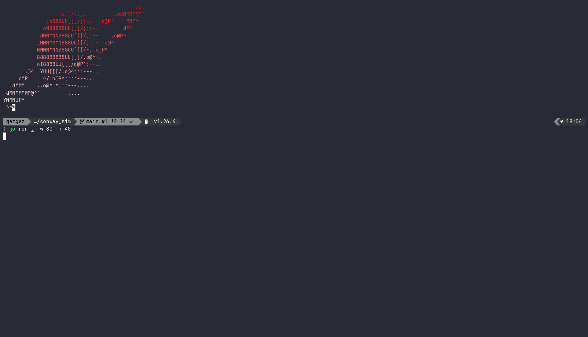
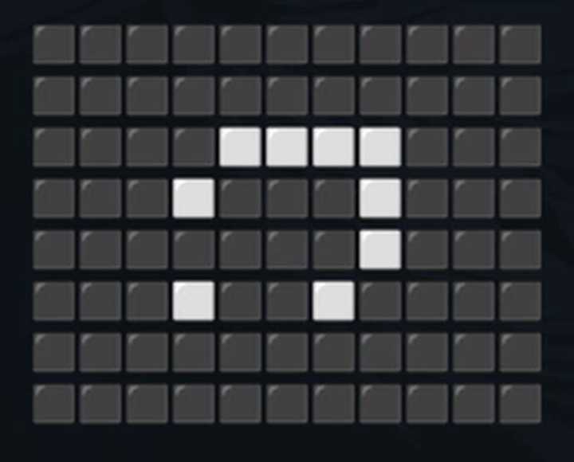
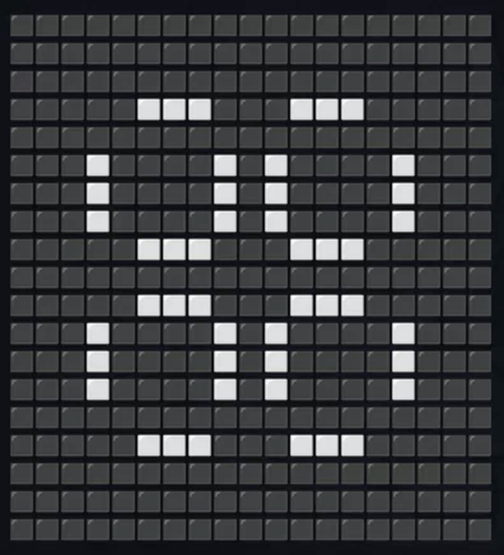

# Game of Life (terminal)

Conway's Game of Life in your terminal, written in Go with [Bubble Tea](https://github.com/charmbracelet/bubbletea). Pause it, change the speed, and step backwards and forwards through the last 200 generations.

<!-- Put the random-grid demo here. GitHub renders .mp4 only when uploaded through its editor (drag it into the README editor), otherwise convert it to a gif. -->



## Features

- **Toroidal grid**: the edges wrap around, so a glider that leaves one side comes back on the other.
- **Step through time**: pause, then move back and forth through the last 200 generations.
- **Adjustable speed**: 1 to 25 generations per second.
- **Presets** for well-known patterns, or a random starting grid.
- **Custom cell characters**: use emoji, or plain ASCII like `.` and `x`.

## Run it

Requires Go 1.22 or newer.

```bash
git clone https://github.com/1Gazzar1/conway_sim
cd conway_sim
go run .
```

## Controls

| Key             | Action                                                    |
| --------------- | --------------------------------------------------------- |
| `Space`         | Pause / resume                                            |
| `+` / `-`       | Speed up / slow down                                      |
| `←` / `→`       | Step one generation back / forward (pauses automatically) |
| `q` or `Ctrl+C` | Quit                                                      |

## Flags

| Flag      | Default | Description                                                     |
| --------- | ------- | --------------------------------------------------------------- |
| `-w`      | `30`    | Grid width (min 3)                                              |
| `-h`      | `20`    | Grid height (min 3)                                             |
| `-a`      | `⬜`    | Character for an alive cell                                     |
| `-d`      | `⬛`    | Character for a dead cell                                       |
| `-preset` | none    | Start from a named pattern (see below). Overrides `-w` and `-h` |

The alive and dead characters must have the same display width (for example `⬜`/`⬛`, or `.`/`x`). The grid has to fit in your terminal, so make the window bigger or the grid smaller if you get a size error.

```bash
go run . -w 60 -h 25                  # bigger random grid
go run . -a "#" -d "." -w 40 -h 20    # ASCII cells
go run . -preset glider
```

## Presets

Presets are placed in a small padded grid, so `-w` and `-h` are ignored when you use one.

| Preset    | What it does                                |
| --------- | ------------------------------------------- |
| `blinker` | Period-2 oscillator                         |
| `toad`    | Period-2 oscillator                         |
| `beacon`  | Period-2 oscillator                         |
| `pulsar`  | Period-3 oscillator                         |
| `square`  | Still life, never changes                   |
| `glider`  | Travels diagonally across the grid          |
| `lwss`    | Lightweight spaceship, travels horizontally |
| `diehard` | Dies out completely after 130 generations   |
| `ggg`     | Gosper glider gun, keeps producing gliders  |

|               Toad                |                Beacon                 |
| :-------------------------------: | :-----------------------------------: |
|  |  |

|                Glider                 |       Lightweight spaceship       |
| :-----------------------------------: | :-------------------------------: |
|  |  |

|                Pulsar                 |
| :-----------------------------------: |
|  |

## How it works

The simulation and the UI run separately:

- **Sparse state**: the live cells are kept in a set of `(x, y)` points. Each generation only looks at live cells and their neighbors, instead of scanning the whole grid.
- **Generator goroutine**: a worker computes generations in the background and appends each one to a history of the last 200 frames.
- **Backpressure**: the worker and the UI share a buffered channel (capacity 100). The worker sends a signal for every generation it produces and the UI receives one each time it moves to a new generation, so the worker can never get more than about 100 generations ahead.
- **History**: the UI just reads frames from the history by generation number. That is what makes pausing and stepping backwards cheap, since nothing is recomputed.
- **UI**: a Bubble Tea model with a ticker whose interval comes from the speed setting. Rendering builds the whole frame in a `strings.Builder` and centers it using the display width of the chosen cell characters (via `go-runewidth`).

## Project layout

| File          | Purpose                                                       |
| ------------- | ------------------------------------------------------------- |
| `main.go`     | Flag parsing, validation, wiring everything together          |
| `config.go`   | Grid state, random grid generation, thread-safe frame history |
| `generate.go` | Background worker that produces generations                   |
| `rules.go`    | Neighbor counting and the birth/survival rules                |
| `presets.go`  | Pattern library and padding helper                            |
| `tea.go`      | Bubble Tea model, key handling, rendering                     |

## Known limitations

- Very large grids (hundreds by hundreds) run slower than the requested speed, because every generation allocates a full grid.
- The grid is sized once at startup, so resizing the terminal while it runs is not handled.

## Rules

1. A live cell with 2 or 3 live neighbors survives.
2. A dead cell with exactly 3 live neighbors becomes alive.
3. Every other cell is dead in the next generation.
